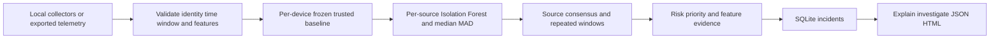

# ThreatLens CLI

ThreatLens detects behavioral anomalies that may indicate compromise, without requiring known malicious hashes, IP addresses, domains, or signatures. It combines **Isolation Forest, robust statistical deviation, and persistence across observation windows**, with separate trusted baselines for each device.

This is a Python command-line application, not an Electron or Android application. Version 0.2 provides a working local and offline investigation workflow for the class problem statement. An alert is evidence to investigate, not proof of compromise.

## What works

- Local system, process, and socket telemetry through `psutil`.
- Validated JSON telemetry for **systems, routers, firewalls, and networks**.
- A native importer for **Zeek `conn.log` TSV** exports.
- Explicit trusted learning, frozen baselines, per-source models, and repeated-window detection.
- Missing-telemetry reporting, replay rejection, transactional updates, and incident deduplication.
- SQLite evidence storage, explanation and investigation commands, private JSON and standalone HTML reports.
- A reproducible four-device demo, full-pipeline benchmark, tests, lint, dependency lock, Python wheel and source distribution, and CI.

Router and firewall support uses exported aggregate metrics supplied through the documented contract. There is no automatic login, SNMP polling, or vendor-specific live collector. The Zeek importer analyzes recorded connection behavior. Only local collection inspects the current machine.

## Install

Use Python 3.11 or newer. Python 3.12 or 3.13 is a convenient choice.

```bash
git clone https://github.com/samiksha-jangid27/ThreatLens-CLI.git
cd ThreatLens-CLI
python3 -m venv .venv
source .venv/bin/activate
python -m pip install --upgrade pip
python -m pip install ".[dev]"
threatlens --help
```

On Windows, use `py -3 -m venv .venv`, then `.venv\Scripts\Activate.ps1` in PowerShell. Every command also works as `python -m threatlens ...`.

For the exact resolved development dependencies, install [uv](https://docs.astral.sh/uv/) and run `uv sync --frozen --extra dev`, then use `uv run threatlens --help`. The regular pip installation resolves within the declared version ranges.

## Check the actual computer after cloning

After installation, run:

```bash
python -m threatlens check
```

This reads the current computer's real system/process/socket telemetry and displays
its available aggregate metrics and permission-related blind spots. It uses no
synthetic fixtures, requires no baseline, and does not train, modify devices, or
write detection state. Restricted sources are reported explicitly. It is a
current-condition snapshot, not a malware scan or a verdict that the Mac is safe.

For machine-readable output or an optional private snapshot:

```bash
python -m threatlens check --json
python -m threatlens check --output live-snapshot.json
```

To assess behavioral deviations on that same computer, explicitly approve a
known-normal learning period first. A system-only profile works without requiring
privileged access to socket metadata:

```bash
python -m threatlens learn --sources system --samples 30 --interval 1
python -m threatlens scan --sources system
```

Repeat scans to observe changes over time. Thirty samples are a readiness minimum,
not proof that the training period represents every normal workload. An initially
compromised host can contaminate trusted learning. A quiet scan is not proof of safety.

## Run the submission demo

This uses synthetic fixtures and an isolated state directory. It does not attack or alter any device.

```bash
python scripts/demo.py --output demo-artifacts
```

The demo learns 60 trusted windows for each device type, checks benign and suspicious windows, then saves four scan results, an incident report in JSON and HTML, and the benchmark. Open `demo-artifacts/incidents.html` in a browser. Choose a new output directory for each rerun.

For one device manually, set a private state directory first:

```bash
export THREATLENS_DATA_DIR="$PWD/.threatlens-data"
threatlens learn --input examples/router-baseline.json
threatlens scan --input examples/router-normal.json
threatlens scan --input examples/router-suspicious.json --json
threatlens incidents
threatlens explain 1 --json
threatlens investigate 1
threatlens report --format html --output router-report.html
```

In PowerShell use `$env:THREATLENS_DATA_DIR = "$PWD/.threatlens-data"`. With no variable, state defaults to `~/.threatlens/threatlens.db`. Paths are resolved at command runtime. Existing reports are never overwritten.

## Monitor the local machine

Only learn while you have reason to trust the host and its workload. Thirty windows are a software readiness minimum, not proof of a representative baseline.

```bash
threatlens learn --samples 30 --interval 1
threatlens scan
threatlens status --json
```

A local observation samples CPU for approximately one second. `--interval` is the pause between samples. Some operating systems restrict network or process visibility. ThreatLens reports unavailable sources. To deliberately use a narrower profile, use the same selection during learning and scanning:

```bash
threatlens learn --sources system --samples 30
threatlens scan --sources system
```

A single-source profile can escalate only after repeated corroborated windows. An untrained scan returns `INSUFFICIENT_BASELINE`, never a claim that the host is clean. Scanning never changes the training baseline. Relearning is explicit; `learn --replace` replaces the selected device's baseline and temporal state while preserving existing incidents.

## Import network logs

```bash
threatlens import-zeek --input conn.log --device-id lab-sensor \
  --window-seconds 60 --output network-windows.json
```

Use separate trusted training and later assessment logs, then `learn --input` and `scan --input` on their converted files. `orig_bytes` and `resp_bytes` are attributed to the connection's start window; these are completed-flow totals, not interface throughput measurements. See [telemetry contract](docs/telemetry.md) for all fields and limitations.

## Detection and false alarms



A source is corroborated when robust deviation exceeds threshold 3.5 and either Isolation Forest also flags it or the absolute robust score reaches 6. An alert requires two corroborated sources in one window or a corroborated source in two consecutive comparable windows. This is an engineering heuristic, not an assertion of statistical independence or a new ML algorithm. Read the [methodology](docs/detection-methodology.md) for the exact rules.

Risk scores prioritize investigation; they are not probabilities. Source signals can be correlated with one another. Normal backups, maintenance, or deployments may trigger alerts. Low-impact attacks may remain undetected.

## Evaluation

```bash
threatlens benchmark --json
threatlens benchmark --component   # original small statistical smoke benchmark
python -m pytest -q
make check
python -m build
```

The default benchmark assesses **32 held-out synthetic scenarios**, across four device profiles, with 60 training windows per profile. For the documented seed 42 run:

| Method | Precision | Recall | F1 | False positive rate |
| --- | ---: | ---: | ---: | ---: |
| Full detector | 66.67% | 66.67% | 66.67% | 20.00% |
| Isolation Forest only | 40.00% | 66.67% | 50.00% | 60.00% |
| Robust statistics only | 40.00% | 66.67% | 50.00% | 60.00% |

The full detector produced 8 true positives, 16 true negatives, 4 false positives, and 4 false negatives, for 75% accuracy. Authorized backups and stealth attacks deliberately expose the remaining limits. These repeated profile patterns are not independent real-world trials. This evaluation does not establish security effectiveness on actual compromised devices. See [evaluation](docs/evaluation.md) and the [validation record](docs/validation.md).

## Commands

| Command | Purpose |
| --- | --- |
| `check` | Inspect actual current computer metrics and visibility without training |
| `learn` | Explicitly trust local samples or an imported batch |
| `scan` | Assess one local sample or an imported batch |
| `collect` | Export aggregate local telemetry |
| `import-zeek` | Convert a Zeek TSV connection log |
| `status` | Inspect baseline readiness and state location |
| `incidents` | List stored incidents, optionally `--json` |
| `explain ID` | Show saved detection evidence, optionally `--json` |
| `investigate ID` | Show priority and investigation advice |
| `report` | Export terminal, JSON, or HTML incident reports |
| `benchmark` | Run the synthetic full-pipeline evaluation |
| `version` | Display the installed version |

Exit codes: `0` completed; `1` incident not found; `2` invalid input or operational failure; `3` suspicious telemetry when `scan --fail-on-alert` is set; `4` insufficient baseline. `REVIEW` and degraded coverage remain visible in the result; exit 0 never means the device is proven uncompromised.

## Submission and learning material

- [Architecture and storage](docs/architecture.md)
- [Detection methodology](docs/detection-methodology.md)
- [Input schema and adapter guide](docs/telemetry.md)
- [Evaluation design](docs/evaluation.md)
- [Threat model and privacy](docs/threat-model.md)
- [Submission checklist and rubric mapping](docs/submission.md)
- [Beginner guide and viva preparation](docs/learning-guide.md)
- [Validation evidence](docs/validation.md)
- [Contributing](CONTRIBUTING.md) and [security reporting](SECURITY.md)

The formal report is included under `docs/submission/` in editable Word and PDF formats.

## Packaging and deployment boundary

`python -m build` creates a wheel and source archive under `dist/`. These can be installed with pip; the wheel still needs compatible Python and platform-specific dependencies. Docker runs the CLI with private state under `/data`; a container observes its own namespaces, not automatically the host or physical network.

Native executables, installers, app-store publication, and hosted services are future release work. No deployment or public package publication is performed by these source changes. The repository retains its existing **all rights reserved** license; a public GitHub repository is not an open-source license grant.
