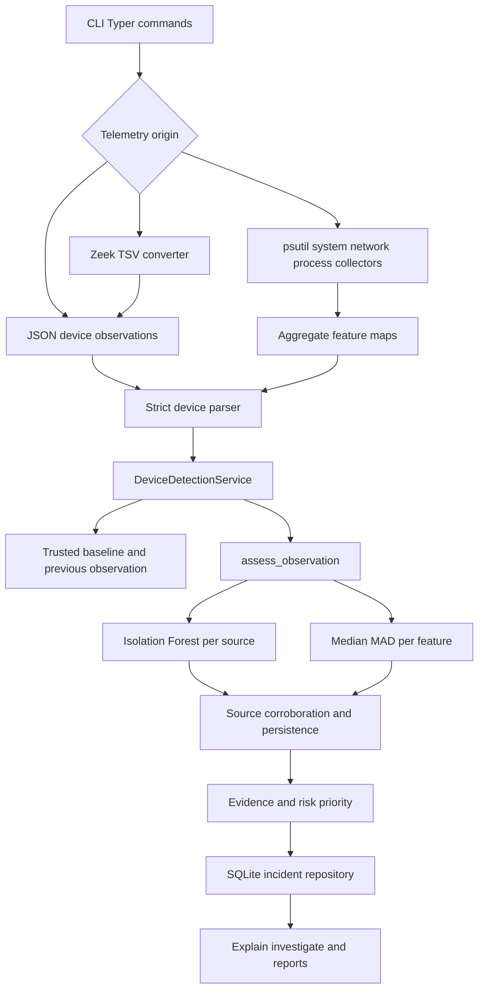

# Architecture

ThreatLens 0.2 is a local Python CLI with an offline import path. There is no Electron renderer, web backend, cloud API, or mandatory external inference service. The runtime detector is `detection/device.py`; the original endpoint pipeline remains as a tested component implementation for reference, not the CLI's current orchestration path.

## Components

| Layer | Main implementation | Responsibility |
| --- | --- | --- |
| CLI | `cli/app.py`, `cli/commands/` | Arguments, exit codes, terminal and JSON output |
| Local adapters | `collectors/device.py` and source collectors | Concurrent sampling, explicit visibility failures |
| Import adapters | `ingestion/device.py`, `ingestion/zeek.py` | Bounded parsing and log conversion |
| Contract | `schema/device.py` | Device identity, source vocabulary, finite metrics, timestamps |
| Features | `features/` | Aggregate system, socket and process behavior |
| Detection | `detection/device.py` | Baseline policy, scoring, consensus, persistence, transactions |
| Models | `models/isolation_forest.py`, `detection/behavioral.py` | Seeded unsupervised ML and robust statistics |
| Persistence | `storage/database.py`, `storage/repositories.py` | SQLite migrations, evidence and per-device state |
| Reporting | `reporting/`, incident commands | Saved evidence, JSON and escaped standalone HTML |
| Evaluation | `evaluation/device_benchmark.py` | Shared production assessment function, scenarios and ablations |

## State and transactions

`THREATLENS_DATA_DIR` selects the directory; the default is `~/.threatlens`. The database contains:

- `incidents`: original incident columns plus a `detection` JSON column containing the full original assessment, feature evidence, device identity and algorithm version.
- `device_state`: one JSON state per `device_type:device_id`, containing up to 500 explicitly trusted training observations, the last observed window, anomaly streaks and any continuing incident episode.

An additive migration retains original incident IDs and signal-only records. New evidence cannot be reconstructed for old records that never stored it. The three legacy JSON baseline files from 0.1 are not imported automatically: the new profile contract and explicit trust policy require relearning.

Learning and scan batches use `BEGIN IMMEDIATE`. State updates and incident creation commit together. If a later window in a batch is invalid or replayed, earlier updates from that batch roll back. SQLite serializes writers with a 10-second lock timeout. Connections close after each operation. This is suitable for a class prototype and modest local workloads, not a distributed event store.

Database and exported report files are created with owner-only POSIX permissions. Existing files are not overwritten by report and telemetry exports. OS filesystem permissions and the security of the user account remain part of the trust boundary; there is no encryption or tamper-evident log.

## Model lifecycle

A per-source Isolation Forest is rebuilt from the bounded trusted baseline for each assessment. This keeps the model reproducible from inspectable numeric state and avoids loading executable pickle artifacts. It costs CPU and limits high-rate scalability. The baseline is frozen during scans; retraining happens only through an explicit `learn` operation. There is no claim of automatic concept-drift correction.

Device identity includes the type and supplied ID. IDs are operator assertions, not authenticated device certificates. Profiles must keep metric meaning, units and observation window consistent. An added source or changed feature set requires deliberate relearning.

## Local visibility

CPU and process samples run concurrently; socket data is a snapshot during that collection. Uptime remains raw context but is excluded from model features. Process CPU is measured after priming instead of trusting the first zero reading. If processes exit or are inaccessible, the process source is conservatively unavailable. Network denial is reported as unavailable, never an empty healthy network. A selected narrower profile is assessed only for its trained sources.
